# Screenshots

Real windows of Zulip Tray with made-up people and a made-up server. The tray menus are GNOME Shell's to draw, so on the desktop they look slightly different; their content is the same.

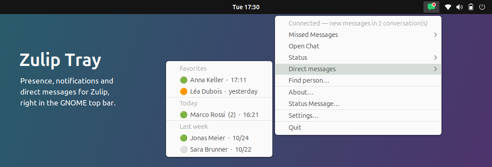

## Tray

The icon shows your presence as the server sees it, with a red badge for missed messages (blinking, if enabled).

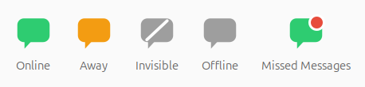

<table>
  <tr>
    <td align="center" valign="top">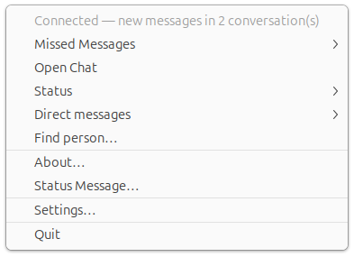 Tray menu</td>
    <td align="center" valign="top">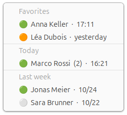 Direct messages: favorites and recent people, with presence, unread count and last message</td>
  </tr>
  <tr>
    <td align="center" valign="top">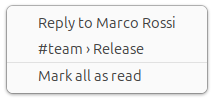 Missed messages, with "Mark all as read"</td>
    <td></td>
  </tr>
</table>

## Person search

Opened from the tray menu or with `zulip-tray --search`, e.g. on a keyboard shortcut such as Super+Z.

<table>
  <tr>
    <td align="center" valign="top">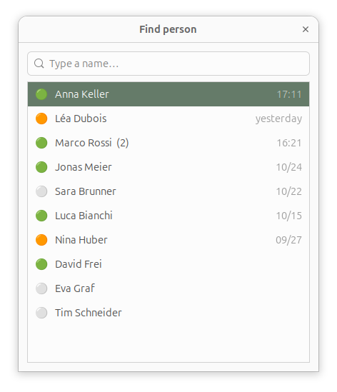 Favorites and recent people first</td>
    <td align="center" valign="top">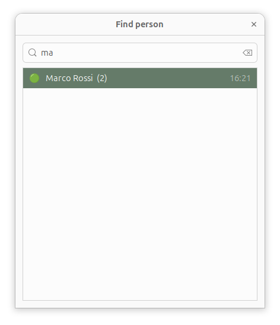 Type to filter, Enter opens the conversation</td>
  </tr>
</table>

## Reply from a notification

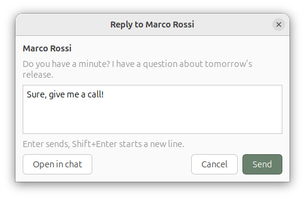

## Settings

<table>
  <tr>
    <td align="center" valign="top">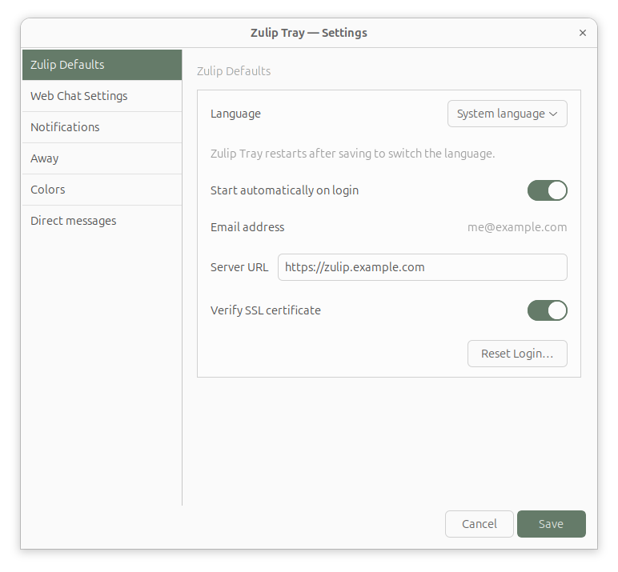 Language, autostart, server</td>
    <td align="center" valign="top">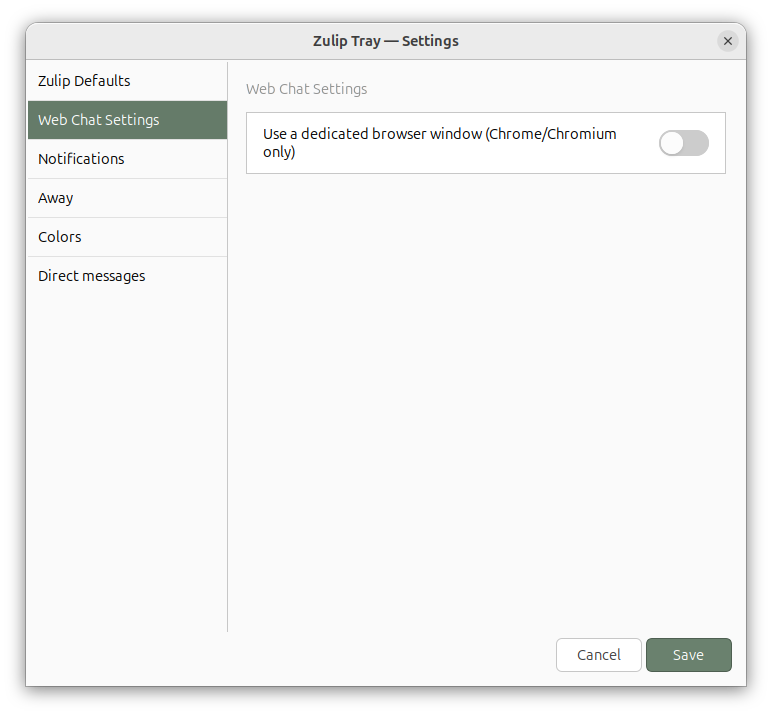 Web chat</td>
  </tr>
  <tr>
    <td align="center" valign="top">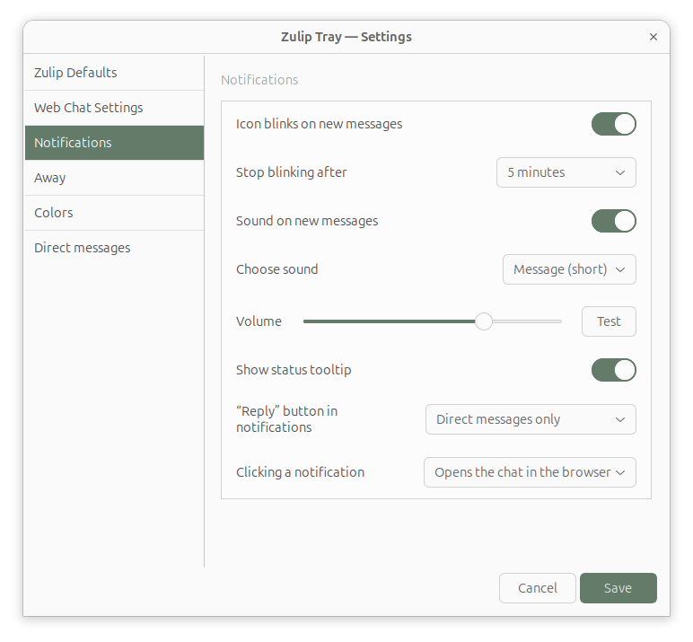 Notifications</td>
    <td align="center" valign="top">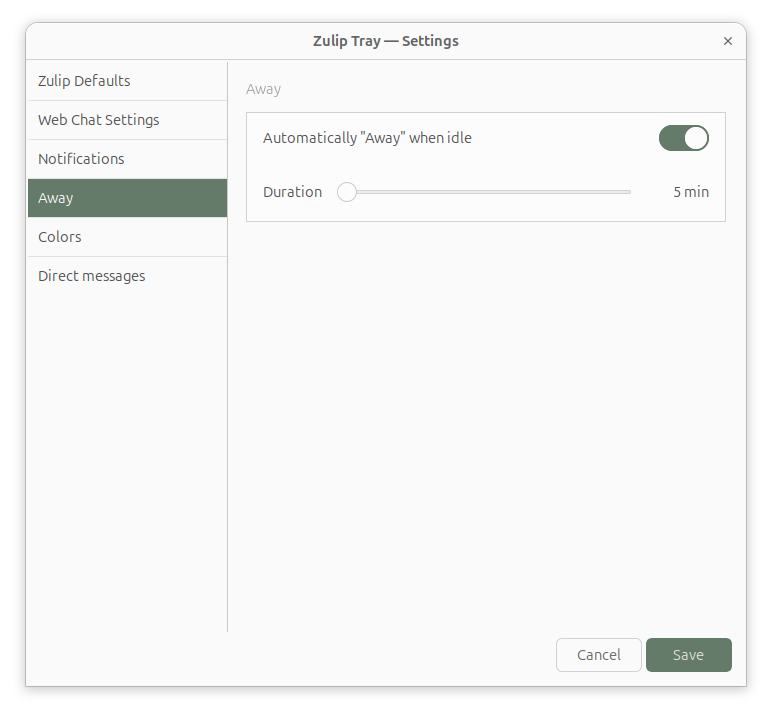 Away</td>
  </tr>
  <tr>
    <td align="center" valign="top">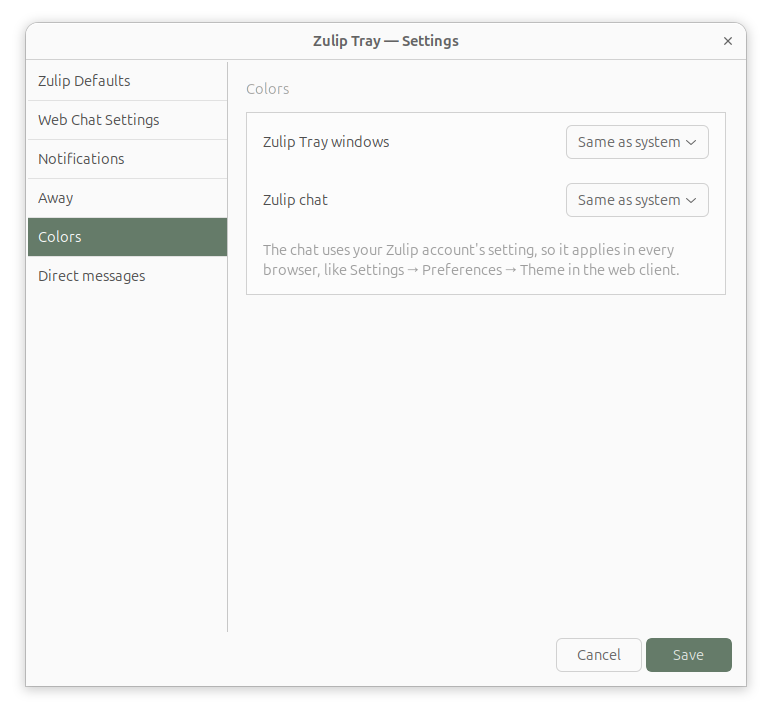 Colours</td>
    <td align="center" valign="top">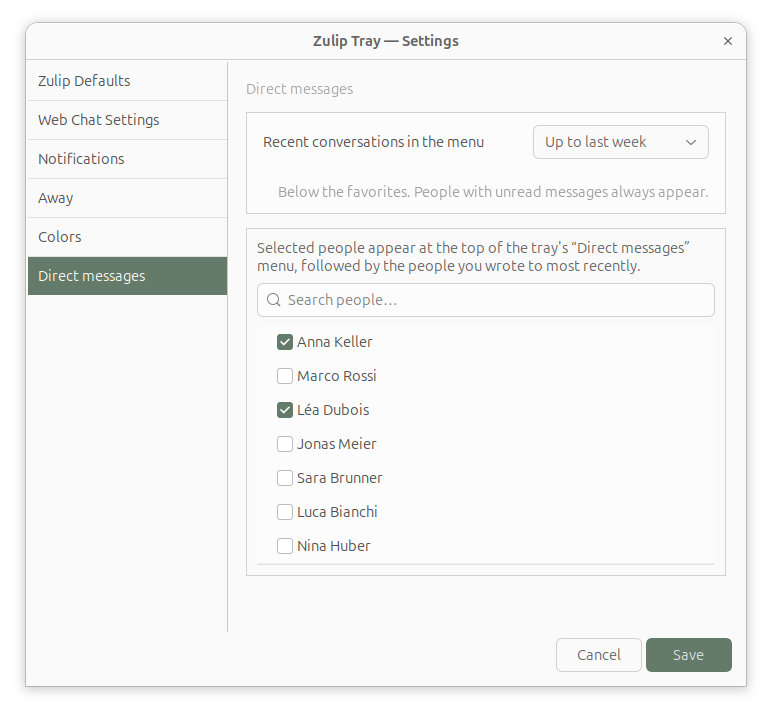 Direct messages: recent range and favorites</td>
  </tr>
</table>
